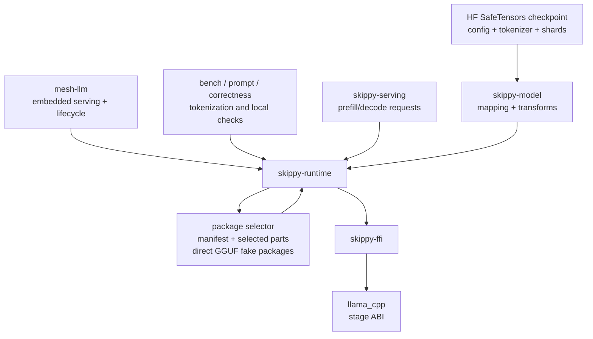

# skippy-runtime

Safe Rust wrapper around the experimental skippy C ABI.

This crate owns Rust-side model/session wrappers and converts raw ABI buffers
into typed runtime structures.

## Architecture Role

`skippy-runtime` is the safe model/session layer used by mesh, servers,
diagnostic prompt clients, benchmarks, correctness checks, and slicing tools.
It does not own TCP transport, mesh lifecycle, or telemetry export.

### Experimental draft readout

`SKIPPY_DFLASH_GPU_READOUT=1` attaches stateless greedy backend samplers to
DFlash/DSpark draft lanes. Supported backends select token IDs on the device,
but the current native greedy sampler also retains its logits output, so this
does not eliminate vocabulary-sized readback. Missing optional sampler exports,
refused attachments, or a backend returning processed logits retain host
argmax. DFlash2 continues to read its selector lattice. The target sampler and
verification semantics are unchanged.

`SKIPPY_DFLASH_DEVICE_FEATURES=1` enables direct device-row feature injection
for a complete local target with strictly ordered capture layers. The draft
consumes the capture buffer before the next target forward; upstream device
events protect its lifetime. Unsupported layouts or missing optional exports
keep the host feature path. This requires native ABI `0.1.81`, whose graph
admission explicitly validates auxiliary capture writes. Both optimizations
remain opt-in pending repeatable end-to-end gains.

`StageSession::verify_batch_sampled` accepts requests from
`verification_batch::VerifyBatchRequest` and shares a target forward across
equal-length speculative windows. Each lane retains its own sampling history,
checkpoint and rejection boundary. Callers must resolve every window through
trim or retirement. This API is initially exercised by the concurrent DFlash
diagnostic. Serving can opt into scheduler coalescing with
`SKIPPY_SHARED_VERIFY=1`; see the serving crate's README.

`StageSession::dflash_propose_batch` accepts
`dflash::proposal_batch::DFlashBatchRequest` values. Compatible lanes share
one noise-block forward, including different requested block lengths. Each
lane keeps its own feature context, and every scratch block is removed after
readout. Native capacity limits, separate draft models, and selector or
convolution heads retain independent submissions. Draft failure clears the
affected draft contexts and returns empty proposals without changing target
state. `DFlashDraftStats::shared_proposals` counts observed shared submissions.

The default remains host readout until matched parity and performance trials
qualify the backend path. `StageModel::dflash_backend_readout_rows` distinguishes
observed token rows from host fallbacks; attachment alone is not evidence of
offload. Compare `llama-spec-bench --dflash` with the variable unset and set to
`1`, using the same models, prompt corpus, draft window and native build.

For inference, the runtime opens a stage view, creates a session, runs prefill
or decode for that stage's layer range, and returns either an activation frame
for downstream stages or a predicted token on the final stage. KV page
state export/import also passes through this crate for runtimes that expose
native exact-cache movement.

## Responsibilities

- open staged model views
- open local Hugging Face SafeTensors checkpoints directly, with optional
  tensor-by-tensor load-time quantization and no intermediate GGUF
- create runtime sessions
- tokenize and detokenize through llama
- run prefill/decode calls
- set llama.cpp context options needed by staged serving, including K/V cache
  type selection for upstream-supported cache types and selected backend device
  placement
- expose activation frames with descriptors and payloads
- select layer-package parts from local or Hugging Face package refs
- validate package ABI/manifest compatibility before loading or composing parts
- expose declared `mmproj` projector artifacts from package manifests for
  multimodal serving
- compose materialized package stages for tools that need a concrete GGUF path
- open selected package parts directly through the ABI for server runtime loads

Keep service lifecycle, transport, and telemetry in higher-level crates.

## Direct SafeTensors loading

`StageModel::open` recognizes a local checkpoint directory containing
`config.json` plus either `model.safetensors` or
`model.safetensors.index.json`. It also accepts a `.safetensors` file and uses
its parent directory for the checkpoint metadata. Set
`RuntimeConfig::checkpoint_quantization` to preserve the canonical checkpoint
types or select a supported llama.cpp quantization recipe such as `Bf16`,
`Q4KM`, `IQ2XXS`, or `Q8_0`. Importance-aware recipes use
`RuntimeConfig::checkpoint_imatrix`; relative paths resolve from the checkpoint
directory, and required tensor entries are validated before model allocation.
The shipped runtime exposes the same settings as
`mesh-llm serve --quant <RECIPE>` and `--checkpoint-imatrix <PATH>`; explicit
CLI values take precedence over both default and model-local configuration.

The runtime validates immutable shards with the official Rust `safetensors`
crate. `skippy-model` maps and transforms source tensors, while the native
Skippy ABI chooses destination tensor types and quantizes each stage-owned
tensor as it is loaded. This initial direct path does not materialize a derived
artifact cache and does not emit the GGUF model-open progress events.
